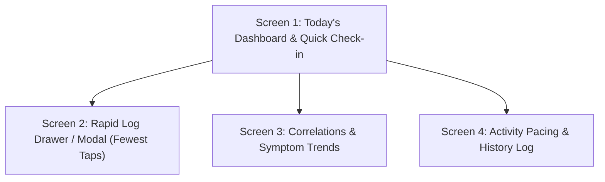

# Project Brief & Background Specification

## 1. Executive Summary & Purpose

- **Project Title:** Personal Fibromyalgia Symptom & Activity Correlation Tracker
- **Target User:** Solo / Personal use (no onboarding walls, account creation, or social sharing)
- **Core Objective:** Provide a low-friction tool to log daily physical activity, pain levels, and fibromyalgia symptoms in seconds, then surface clear correlations between activities, rest patterns, and flare-ups.
- **Design Philosophy:** **Ultra-fast, low-cognitive-load logging** (fewest taps possible; designed for use during brain fog, fatigue, or high-pain states).

---

## 2. Problem Statement & Domain Context

Fibromyalgia is characterized by chronic widespread musculoskeletal pain, fatigue, sleep disturbances, cognitive difficulties ("fibro fog"), and heightened sensitivity.

- Traditional fitness apps assume linear progression, push users toward high exertion, and penalize inactivity.
- Traditional symptom trackers often require tedious, multi-step clinical surveys that are overwhelming during bad flare days.
- **The Solution:** A hybrid tracker sitting between fitness and habit tracking that treats _pacing_ and _correlation discovery_ as primary goals.

---

## 3. Core Feature Pillars

### A. Low-Friction Daily Logging (Two-Stage AM/PM Cadence)

- **Morning Baseline Check-in (AM):**
  - Captures unmedicated waking state: Sleep quality (restful vs. unrestorative), morning stiffness, waking pain (0–10 gauge), and initial energy battery level ("starting spoons").
- **Afternoon / Evening Reflection Check-in (PM):**
  - Captures daily exertion & symptom response: Movement activities completed (walk, stretch, chores, rest), end-of-day pain score (0–10), fibro fog severity, and remaining battery.
- **Activity-to-Lag Correlation Value:** Directly powers the correlation engine by comparing Day 1's PM exertion against Day 2's AM stiffness/pain.

### B. Daily Dashboard (Today's Glance)

- **Current Day Status Card:** Today's logged pain score + energy balance.
- **Quick Log Trigger:** Prominent, instant-access action button at the top/thumb zone.
- **Pacing / Energy Budget Gauge:** "Battery" or "Spoon Theory" visual representation showing exertion vs. recovery.
- **Recent Activities & Log Timeline:** Micro-cards showing timestamps of what was logged today.

### C. Correlation & Analytics Engine

- **Activity vs. Pain Lag Analysis:** Shows trends like:
  - _"Higher walking duration on Day 1 correlates with increased pain +18h later."_
  - _"Stretching routine correlates with 25% lower morning stiffness."_
- **Symptom Heatmap / Calendar:** Visual day-by-day intensity matrix to identify flare patterns across weeks/months.
- **Weather / External Factors (Optional future hook):** Barometric pressure and temperature impact correlations.

### D. Activity & Routine Catalog

- Lightweight presets tailored for chronic illness pacing:
  - Gentle mobility & stretches
  - Low-impact walking / movement
  - Restorative rest & heat therapy sessions
  - Daily life tasks (housework, desk posture)

---

## 4. User Journey & Screen Architecture

1. **Screen 1: Today's Dashboard**
   - Direct launch screen.
   - Pacing status (Current energy / Spoon level).
   - Daily log summary (Pain score, fatigue score, activity tally).
   - "Quick Log" sticky FAB or top banner.
   - Micro timeline of today's events.

2. **Screen 2: Quick Log Screen / Sheet**
   - Giant numeric/slider input for Pain (0–10).
   - Tap pills for Fatigue & Fog.
   - Tag selector for symptoms & physical activities.
   - 1-tap "Save Entry" (can complete a check-in in under 5 seconds).

3. **Screen 3: Correlation & Insights**
   - Pain vs. Activity overlay chart (dual axis or stacked timelines).
   - Insight cards highlighting discovered patterns & recovery windows.
   - Weekly flare vs. good days distribution.

4. **Screen 4: Log History & Pacing Log**
   - Calendar-based activity and symptom history.
   - List of logged entries with ability to edit or review past flares.

---

## 5. Visual Tone & Component Specifications (Finalized)

- **Visual Tone:** **Botanical Sanctuary** — gentle, grounding, restorative, and non-clinical. Eases cognitive tension and avoids medical anxiety.
- **Controls & Interaction Patterns:**
  - **Pain Gauge:** Tactile fluid track with discrete **whole-integer steps only (0 to 10)**. No confusing fractions or half-increments.
  - **Symptom & Activity Chips:** Pill toggles with generous 48–52px touch areas and checkmark states (`✓ Brain Fog`, `+ Fatigue`, `+ Stiffness`).
  - **Action Bar:** Pill-shaped split actions (Quick dismiss + Primary "Save Entry (1 Tap)").
- **Color Palette:**
  - **Base Canvas:** Linen Warm White (`#FBF9F5`)
  - **Surfaces / Cards:** Pure White (`#FFFFFF`) with subtle warm borders (`#EBE5DC`)
  - **Primary Calming Accent:** Deep Moss Sage (`#2D5A46`)
  - **Secondary Accent:** Muted Terracotta (`#C47151`)
  - **Neutral Warm Fill:** Warm Oat (`#F3EFEA`)
  - **Pain / Flare Indicator:** Soft Plum (`#8C3B4E`) (soft and clear, non-alarming)
  - **Text Primary:** Deep Bark / Espresso (`#1E2220`)
  - **Text Secondary / Muted:** Stone Grey (`#736B63` / `#5D564F`)
- **Typography Pairing:**
  - **Display Titles & Section Headings:** **Young Serif** (chunky, friendly, characterful serif)
  - **Metrics, Numbers & Data:** **Plus Jakarta Sans (Weight 700–800)** (crystal-clear modern geometric numerals with maximum scannability)
  - **Subheadings, Buttons & Body Text:** **Plus Jakarta Sans (Weight 500–700)**
- **Asset & Image Policy:**
  - **No new AI image generation.**
  - Source royalty-free / web icons & illustrations (SVG / reliable URLs) when needed.
  - If sourcing is not possible, too expensive, or takes too long, fall back to clean text labels and typographic descriptions.
- **Cognitive Accessibility:**
  - High contrast text without eye strain.
  - Generous touch targets (at least 48×48px) for days with joint stiffness or tremors.
  - Large display numbers and distinct iconography for instant recognition during brain fog.
