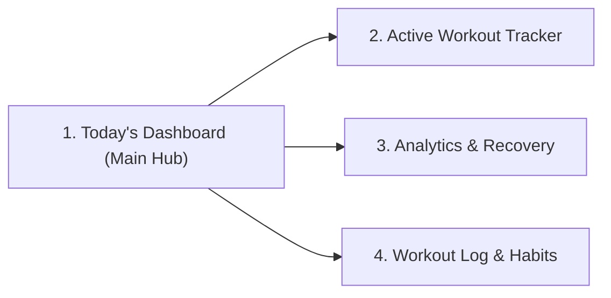

# Project Context: Health, Fitness & Wellness Personal Tracker

## 1. Project Overview

- **Type:** Personal utility app (No onboarding or account setup needed)
- **Platform:** Mobile (iOS / Android), standard mobile viewport: 390 × 844 px
- **Domain:** Personal Health, Workout Tracker & Habit Analytics
- **Visual Style:** Sleek dark athletic palette (Obsidian `#0A0D14`, Surface `#141923`, Neon Lime `#CCFF00`, Clean Cyan `#38BDF8`) for maximum focus and legibility.

---

## 2. Core User Flow

### Screen 1: Today's Dashboard (Main Hub)

- Direct entry point upon launch
- Daily metrics at a glance: Active Energy (kcal), Training Time, Water, Recovery score
- Today's routine card with quick "Start Workout" button
- Bottom navigation bar (Today, Workouts, Analytics, Log)

### Screen 2: Active Workout Tracker

- Session focus screen (Elapsed timer, heart rate zone, current exercise set/reps, next up exercise)

### Screen 3: Analytics & Recovery

- Weekly volume, sleep vs. strain balance, recovery score

### Screen 4: Workout Log & Habits

- Calendar heat map, past sessions, personal records
