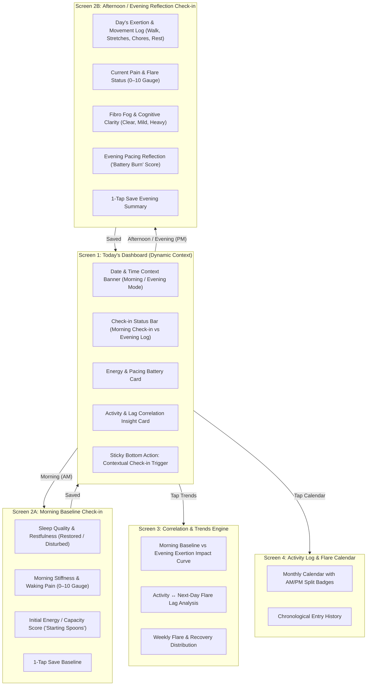

# Screen Architecture & Interaction Flow (Updated: Morning & Evening Check-ins)

---

## Two-Stage Daily Cadence

1. **Morning Baseline Check-in (AM)**
   - **Focus:** Capturing how the body woke up before exertion begins.
   - **Key Inputs:** Sleep quality (restful vs. unrestorative), morning stiffness duration, waking pain score (0–10), and starting energy battery level.
   - **Time to Complete:** ~3–5 seconds.

2. **Afternoon / Evening Reflection Check-in (PM)**
   - **Focus:** Logging physical activities completed, symptom spikes, and pacing toll.
   - **Key Inputs:** Movement activities (walking, mobility, chores, heat therapy), end-of-day pain score (0–10), fibro fog level, and remaining energy battery.
   - **Correlation Value:** Directly matches today's PM exertion against tomorrow's AM baseline to calculate the fibromyalgia pain lag pattern.

---

## Screen Component Inventory

| Screen                    | Core Components Employed                                                       | Primary Goal                                           |
| :------------------------ | :----------------------------------------------------------------------------- | :----------------------------------------------------- |
| **Today's Dashboard**     | AM/PM Dual-Status Indicator, Energy Battery, Insight Banner, Sticky Bottom Bar | Glanceable status under 3 seconds                      |
| **Morning Check-in (AM)** | Sleep Quality Pill, 0–10 Waking Pain Gauge, Starting Spoons Selector           | Establish waking baseline in <5s                       |
| **Evening Check-in (PM)** | 0–10 End-of-Day Pain Gauge, Activity Chips, Fog Severity Toggles               | Log exertion & symptom response in <5s                 |
| **Correlation & Trends**  | Dual-line AM/PM Trend Curve, Lag Discovery Cards                               | Identify how PM activity affects next-day AM stiffness |
| **Log & Calendar**        | Split AM/PM Day Dots on Calendar, Chronological Entries                        | Historical tracking & doctor reporting                 |
